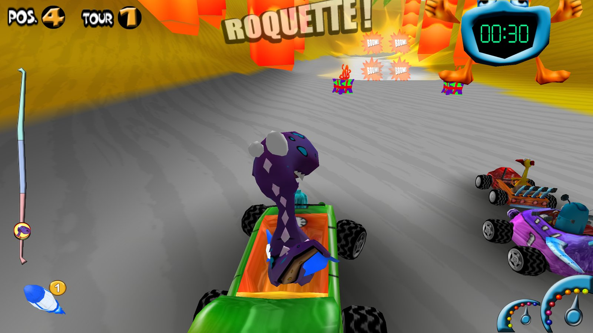
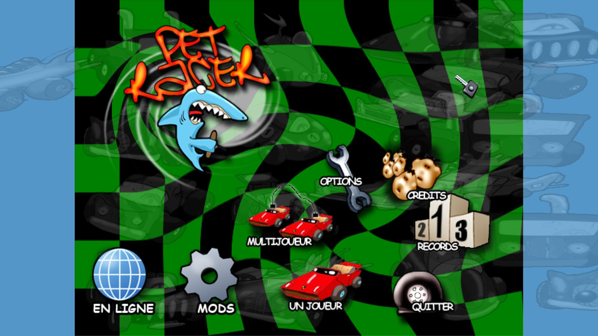
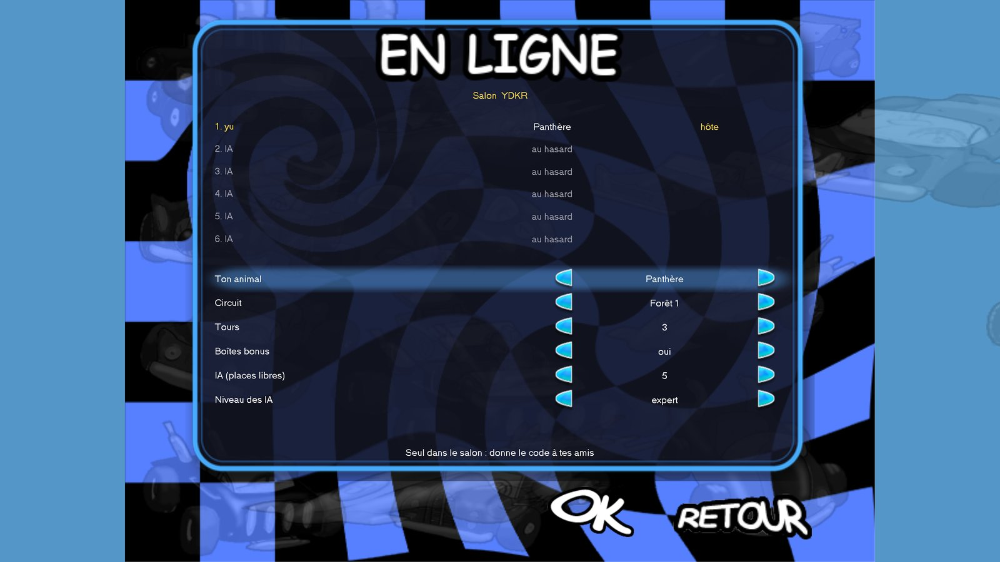
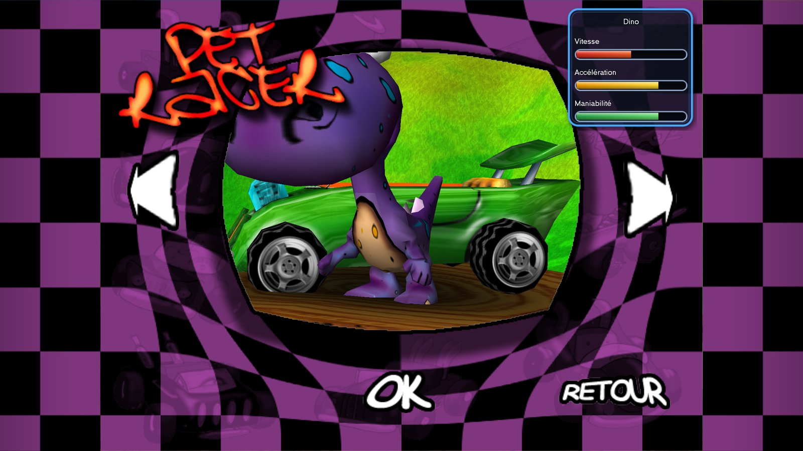
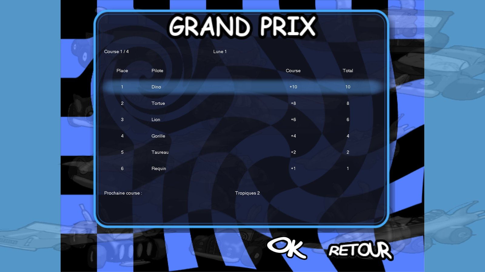
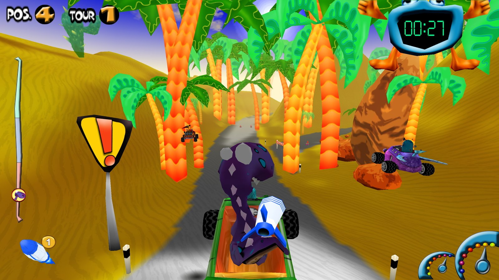
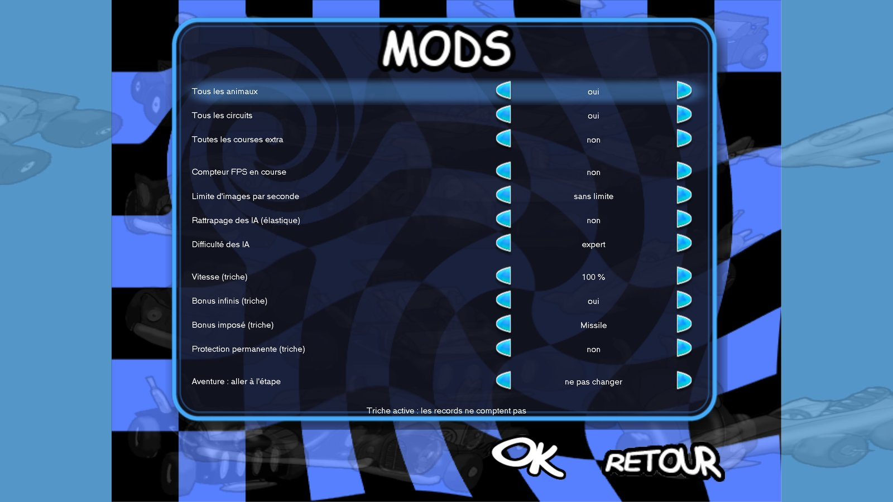
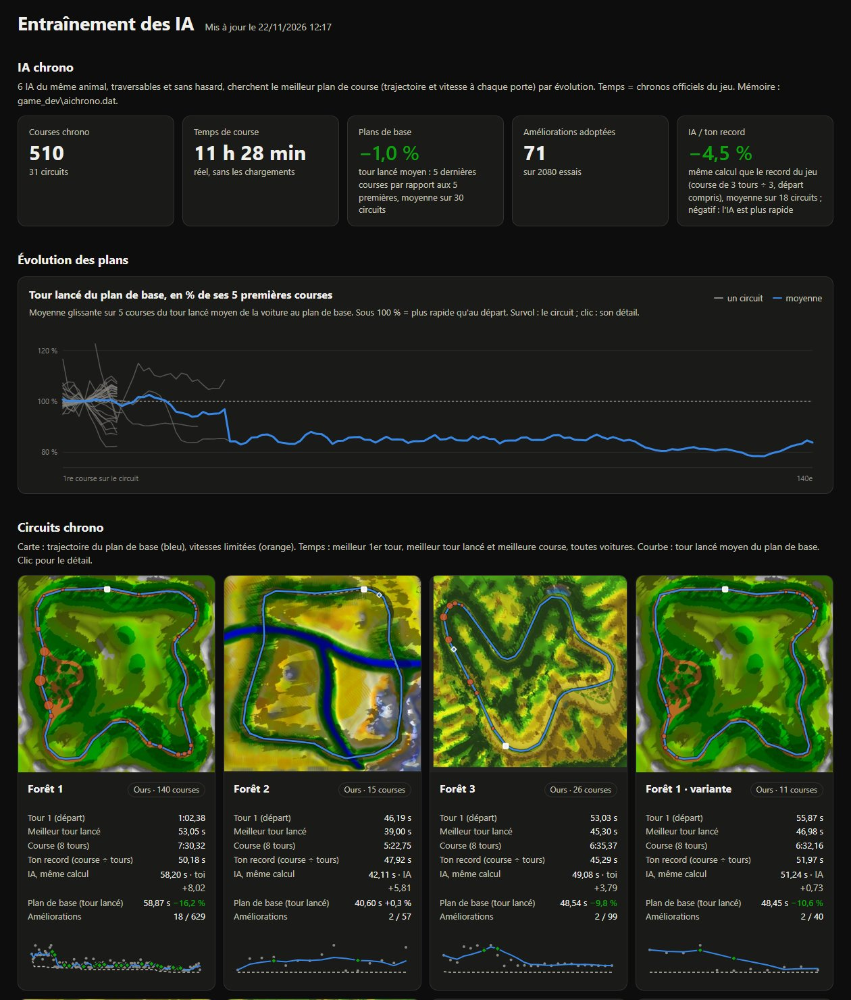

<div align="center">

# Pet Racer — mod communautaire

**Une seconde vie pour Pet Racer (Techland)** : courses en ligne jusqu'à 6, classement Elo, Grand Prix,
nouveaux bonus, une IA refaite et le jeu enfin à l'aise sur un PC moderne (1440p, 4K, 144 Hz).



</div>

> **Le jeu n'est pas fourni.** Ce dépôt contient seulement le mod : il te faut ton propre exemplaire de Pet Racer
> déjà installé.

## Aperçu

<table>
<tr>
<td align="center"><br>Menu principal : en ligne et menu Mods</td>
<td align="center"><br>En ligne : salon à code, jusqu'à 6, IA en renfort</td>
</tr>
<tr>
<td align="center"><br>Choix de l'animal, avec ses stats</td>
<td align="center"><br>Grand Prix : 4 courses, points 10/8/6/4/2/1</td>
</tr>
<tr>
<td align="center"><br>Le Missile (en bleu) : il vise le premier</td>
<td align="center"><br>Menu Mods : déblocages, FPS, difficulté des IA</td>
</tr>
</table>

<p align="center">
<br>
<em>Le rapport d'entraînement des IA : les plans de course s'améliorent circuit après circuit.</em>
</p>

## Ce que le mod ajoute

**En ligne**
- Salons privés à code de 4 lettres, jusqu'à 6 joueurs : l'hôte choisit le circuit, les tours, les bonus et le
  nombre d'IA qui complètent la grille.
- **Partie rapide** classée : file d'attente par Elo, la course part dès que 6 joueurs attendent (ou après 15 s à 2
  ou plus), places vides prises par des IA.
- **Classement Elo** (chaque paire de joueurs compte comme un duel) et page des 10 meilleurs.
- Bonus, pièges, boîtes et chocs entre voitures partagés entre tous les jeux.
- Mode spectateur une fois arrivé, en attendant les autres ; un hôte qui part est remplacé, même en pleine course.

**Modes de jeu**
- **Grand Prix** (menu Un joueur) : coupe de 4 courses sur des circuits tirés au hasard, points 10/8/6/4/2/1,
  classement après chaque course et palmarès par profil.
- Les modes d'origine (aventure, course simple, extras, multijoueur local) restent là.

**Gameplay**
- **IA refaite** : trajectoires à la corde, lâcher d'accélérateur avant les virages, évitement, bonus utilisés à bon escient,
  caractère propre à chaque IA. Difficulté réglable : d'origine, auto, facile, normal, difficile, expert.
- **Les IA apprennent les circuits** : murs touchés et endroits dangereux sont gardés dans `aimap.dat` et servent
  aux courses suivantes. L'installeur fournit une mémoire déjà entraînée à ceux qui n'en ont pas encore.
- **IA chrono** : un entraînement à part fait évoluer, circuit par circuit, un plan de course (ligne, vitesses de
  passage) ; les IA expertes suivent les plans qui battent vraiment leur propre trajectoire (`Data\aiplans.dat`).
- **Bonus** : la Fusée devient jouable, nouveau **Missile** qui vise le premier, tirage des bonus selon la place
  dans la course.
- **Stats des animaux** (accélération, vitesse, virage) affichées à l'écran du choix et réglables dans
  `Data\animals.scr`.

**PC moderne**
- Résolutions modernes (1080p, 1440p, 4K) et écran large : menus 4:3 centrés, HUD aux bords de l'écran.
- Conduite identique quel que soit le nombre d'images par seconde, limiteur d'images (144 par défaut).
- Accents dans les polices du jeu, barre de progression pour 1 à 10 tours, ordre d'arrivée et records corrigés.
- Menu **Mods** (engrenage du menu principal) : déblocages sans toucher à ta progression, compteur FPS, limite
  d'images, difficulté des IA et triches (désactivées en ligne ; une course trichée n'enregistre pas de record).

## Installation

1. Télécharge `PetRacerMod.zip` dans les [Releases](../../releases).
2. Ferme le jeu, puis **décompresse tout le zip** dans un dossier.
3. Double-clique sur `Installer.bat`. Il trouve le dossier du jeu (ou te le demande) et garde une copie des fichiers
   d'origine dans `mod_backup`.
4. Lance le jeu comme d'habitude.

Si Windows affiche « Windows a protégé votre ordinateur » : *Informations complémentaires* puis *Exécuter quand même*.
Le script est lisible : ouvre `install.ps1` dans le Bloc-notes pour voir ce qu'il fait.

**Mise à jour** : relance `Installer.bat` du nouveau zip, tes sauvegardes et l'adresse du serveur sont gardées.
**Désinstallation** : `Desinstaller.bat` remet le jeu exactement comme avant.

## Jouer en ligne

Menu principal, bouton **« En ligne »**. En haut s'affichent ton Elo et ton rang ; la ligne « Que faire ? » propose :

- **Partie rapide** : choisis ton animal puis OK, la course part toute seule quand des adversaires sont trouvés.
  Quitter la course compte comme arrivé dernier.
- **Créer un salon** : donne le code de 4 lettres à tes amis, règle la course et lance quand tout le monde est prêt.
- **Rejoindre un salon** : tape le code, puis OK.
- **Classement** : les 10 meilleurs Elo.

Les joueurs n'ont aucun port à ouvrir. Tout le monde doit avoir la même version du mod.
Ton compte est le fichier `online.dat` du dossier du jeu : ne le partage pas, et garde-le si tu réinstalles.

### Héberger un serveur

Le serveur est un script Python 3, sans dépendance :

```powershell
python server\server.py          # port UDP 7778
```

Il faut rediriger le port **UDP 7778** de ta box vers ce PC et autoriser Python dans le pare-feu.
Les joueurs indiquent ton adresse à l'installation (ou dans `Data\online.scr`). Pour mettre l'adresse directement
dans le zip : `mods\package.ps1 -Server ton.adresse`. Détails : [notes/online.md](notes/online.md).

## Compiler le mod

Il faut une copie du jeu, un JDK 8 et PowerShell. Le guide complet (dossiers de travail, build, liste détaillée
des fichiers touchés par chaque mod, diagnostic) est dans [notes/development.md](notes/development.md).

```powershell
powershell -ExecutionPolicy Bypass -File mods\build.ps1 -Run      # compile, injecte dans game_dev, lance
powershell -ExecutionPolicy Bypass -File mods\package.ps1         # fabrique build\PetRacerMod.zip
powershell -ExecutionPolicy Bypass -File mods\package.ps1 -AiMap  # … en reprenant la mémoire des IA de game_dev
powershell -ExecutionPolicy Bypass -File mods\entrainer-ia.ps1    # les IA courent seules sur tous les circuits (mémoire)
python mods\rapport-ia.py --ouvrir                              # rapport HTML de l'entraînement (build\rapport_ia.html)
python mods\installer\test_installer.py                           # essaie l'installeur sur une fausse copie du jeu
python server\test_server.py                                      # vérifie le serveur sans le jeu
```

La documentation du reverse et de chaque fonctionnalité est dans [notes/](notes/), la feuille de route dans
[notes/roadmap.md](notes/roadmap.md).

## Mentions légales

Projet de fans, non officiel, sans lien avec Techland.
*Pet Racer*, son code, ses graphismes et ses sons appartiennent à leurs ayants droit : ils ne sont pas distribués
ici et ne sont pas couverts par la licence de ce dépôt. Pour jouer, il faut posséder le jeu original.
